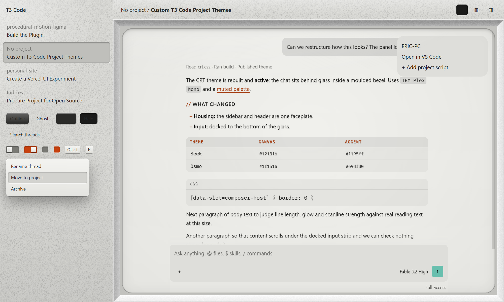

# Faceplate

A theme for T3 Code that makes the app read as a piece of equipment: a moulded satin-plastic
shell, a screen recessed behind a bezel, and controls that behave like physical parts. It has a light and a dark
mode and follows the app's own light/dark setting.

| Light | Dark |
|---|---|
|  |  |

The previews are renders of a stand-in page that uses the app's stylesheet, not screenshots of the app.

## Install

1. Copy both files from `theme/` into T3 Code's themes folder:
   - Windows: `%USERPROFILE%\.t3\userdata\themes`
   - macOS / Linux: `~/.t3/userdata/themes`
2. Pick **Faceplate** in the app's theme settings, or ask an agent in T3 Code to "switch to the Faceplate theme".
3. If the bezel shows as flat colour with no grain, reload the window so the image loads.

`faceplate.png` is the bezel. It must sit next to `faceplate.json` and keep the same base name.

## What it changes

- **Shell:** sidebar and header are one housing with a fine satin grain and a soft sheen.
- **Screen:** the chat sits behind a recessed bezel with four flat sloped faces. Dark mode is a dark tube with faint
  scanlines; light mode is a paper-white screen with dark ink and no scanlines.
- **Controls:** buttons are keys (flush, raised on hover, sunk when pressed), text fields are sunk wells, switches
  are slide switches, sliders are faders, menus and dialogs are raised plates.
- **Input:** a tinted field at the bottom of the screen; text scrolling under it fades out.
- **Type:** the app's own interface font for everything except code, code blocks, tables and key hints, which use
  IBM Plex Mono (embedded).
- **Accent:** amber and teal in dark mode; a single orange in light mode, used for state and marks, not buttons.

## Limits

- Web and desktop only; T3 Code's mobile app does not use themes.
- Native parts of the desktop app (right-click menus, window buttons) cannot be themed.
- Diff internals, the file tree and terminal text only follow the theme's colours.
- Several selectors depend on the app's current markup and class names. A T3 Code update can break parts of the
  theme; the affected parts fall back to the app's default look.
- Built against T3 Code 0.1.10 on Windows.

## Build from source

Requires Node.js. Python 3 with Pillow is only needed to regenerate the bezel image.

```sh
node src/build.js                             # writes theme/faceplate.json
python src/make-bezel.py theme/faceplate.png  # optional: re-render the bezel
```

| File | What it is |
|---|---|
| `src/dark.css`, `src/light.css` | The full stylesheet for each mode. Edit these. |
| `src/roles.json` | The colour roles T3 Code derives its palette from, per mode. |
| `src/build.js` | Merges the two stylesheets, embeds the fonts, writes the theme. |
| `src/make-bezel.py` | Renders the bezel as a 9-slice frame image. |
| `src/fonts/` | IBM Plex Mono Regular and SemiBold, subset to Latin and Latin-1. |

Two things to know before editing:

- A theme's CSS is limited to 50,000 characters, including the embedded fonts. The build fails if it goes over.
- Light mode reuses the dark bezel image, rotated 180 degrees and tone-mapped with a CSS filter, because a theme
  has a single image slot. If you change the tones in `make-bezel.py`, check both modes.

## Credits

IBM Plex Mono is by IBM, licensed under the SIL Open Font License 1.1. The subset files in `src/fonts/` and the
copies embedded in `theme/faceplate.json` are redistributed under that licence.
