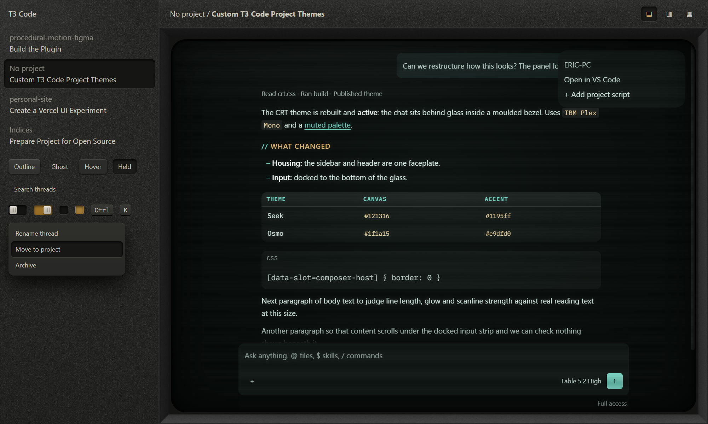

# Faceplate

A theme for T3 Code that makes the app read as a piece of equipment: a moulded satin-plastic
shell, a screen recessed behind a bezel, and controls that behave like physical parts. It has a light and a dark
mode and follows the app's own light/dark setting.

| Light | Dark |
|---|---|
|  |  |

## Install

Paste this into a T3 Code thread:

> Install the Faceplate theme from https://github.com/ericzwu/t3-faceplate-theme. Follow the "Instructions for agents" section of its README.

### Instructions for agents

The theme is two files that must be installed together. Do not pass the theme JSON through `t3_theme_set`; copy the
files instead, so the bezel image comes with it.

1. Call `t3_theme_read` and take `themesDir` from the result. If the tool is unavailable, use
   `~/.t3/userdata/themes` (Windows: `%USERPROFILE%\.t3\userdata\themes`) and create it if it is missing.
2. Download both files into that folder, keeping these exact names:
   - `https://raw.githubusercontent.com/ericzwu/t3-faceplate-theme/main/theme/faceplate.json`
   - `https://raw.githubusercontent.com/ericzwu/t3-faceplate-theme/main/theme/faceplate.png`
3. Call `t3_theme_set` with `themeId: "faceplate"` and no `theme`. If the tool is unavailable, tell the user to pick
   **Faceplate** in Settings → Appearance.
4. Tell the user it is installed, that it follows the app's light/dark setting, and that `t3-chat` restores the
   default theme. Do not change their light/dark setting.

Step 2 as one command:

```sh
# macOS / Linux / Git Bash
d="$HOME/.t3/userdata/themes"; mkdir -p "$d"; for f in faceplate.json faceplate.png; do curl -fsSL "https://raw.githubusercontent.com/ericzwu/t3-faceplate-theme/main/theme/$f" -o "$d/$f"; done
```

```powershell
# Windows PowerShell
$d="$env:USERPROFILE\.t3\userdata\themes"; New-Item -ItemType Directory -Force $d | Out-Null; foreach ($f in 'faceplate.json','faceplate.png') { Invoke-WebRequest "https://raw.githubusercontent.com/ericzwu/t3-faceplate-theme/main/theme/$f" -OutFile "$d\$f" }
```

### By hand

Run the command above for your system, or copy both files from `theme/` into the themes folder yourself. Then pick
**Faceplate** in Settings → Appearance. If the bezel shows as flat colour with no grain, reload the window so the
image loads.

`faceplate.png` is the bezel. It must sit next to `faceplate.json` and keep the same base name. Adding only the JSON
through Settings → Appearance → Add a theme leaves the bezel without its image.

Requires a T3 Code build that accepts 50,000 characters of theme CSS (0.1.10 does).

## What it changes

- **Shell:** sidebar and header are one housing with a fine satin grain and a soft sheen.
- **Screen:** the chat sits behind a recessed bezel with four flat sloped faces. Dark mode is a dark glass
  screen with pale text; light mode is a paper-white screen with dark ink.
- **Controls:** buttons are keys (flush, raised on hover, sunk when pressed), text fields are sunk wells, switches
  are slide switches, sliders are faders, menus and dialogs are raised plates.
- **Input:** a tinted field at the bottom of the screen; text scrolling under it fades out.
- **Type:** the app's own interface font for everything except code, code blocks, tables and key hints, which use
  IBM Plex Mono (embedded).
- **Accent:** amber and teal in dark mode; a single orange in light mode, used for state and marks, not buttons.

## Limits

- Web and desktop only; T3 Code's mobile app does not use themes.
- Native parts of the desktop app (right-click menus, window buttons) cannot be themed.
- Diff internals, the file tree and terminal text only follow the theme's colours.
- Several selectors depend on the app's current markup and class names. A T3 Code update can break parts of the
  theme; the affected parts fall back to the app's default look.
- Built against T3 Code 0.1.10 on Windows.

## Build from source

Requires Node.js. Python 3 with Pillow is only needed to regenerate the bezel image.

```sh
node src/build.js                             # writes theme/faceplate.json
python src/make-bezel.py theme/faceplate.png  # optional: re-render the bezel
```

| File | What it is |
|---|---|
| `src/dark.css`, `src/light.css` | The full stylesheet for each mode. Edit these. |
| `src/roles.json` | The colour roles T3 Code derives its palette from, per mode. |
| `src/build.js` | Merges the two stylesheets, embeds the fonts, writes the theme. |
| `src/make-bezel.py` | Renders the bezel as a 9-slice frame image. |
| `src/fonts/` | IBM Plex Mono Regular and SemiBold, subset to Latin and Latin-1. |

Two things to know before editing:

- A theme's CSS is limited to 50,000 characters, including the embedded fonts. The build fails if it goes over.
- Light mode reuses the dark bezel image, rotated 180 degrees and tone-mapped with a CSS filter, because a theme
  has a single image slot. If you change the tones in `make-bezel.py`, check both modes.

## Credits

The theme is released under the [MIT licence](LICENSE).

The code font is IBM Plex Mono by IBM, licensed under the SIL Open Font License 1.1 ([`src/fonts/OFL.txt`](src/fonts/OFL.txt)).
The theme ships a subset of it (Latin and Latin-1 only), in `src/fonts/` and embedded in `theme/faceplate.json`. Because
the licence reserves the name "Plex" for unmodified copies, the subset is named "IX Mono" in the theme.
